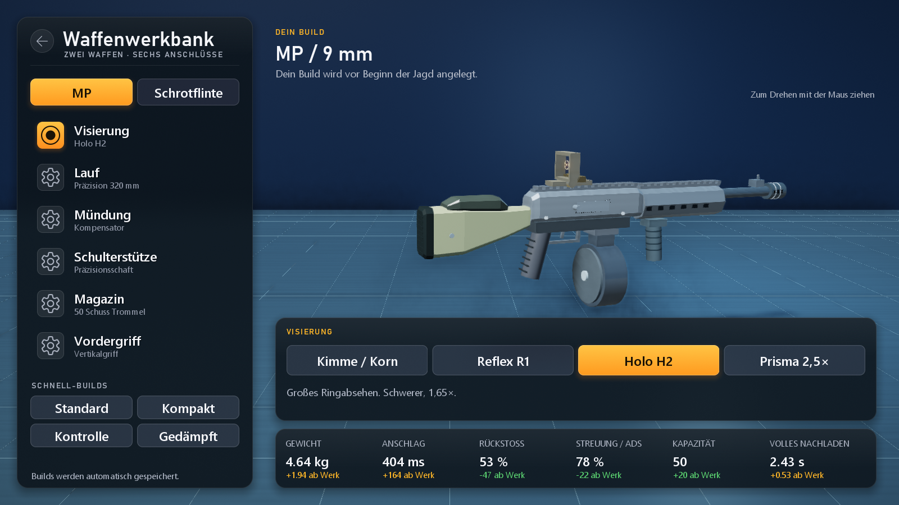
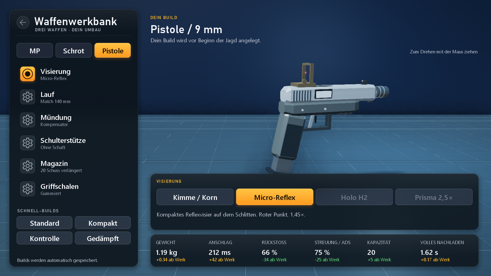
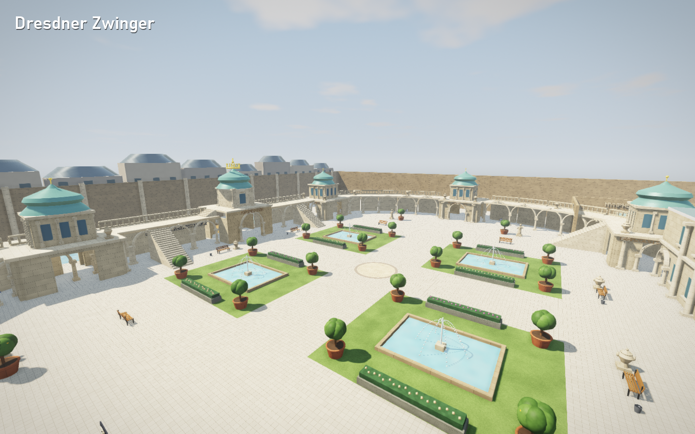
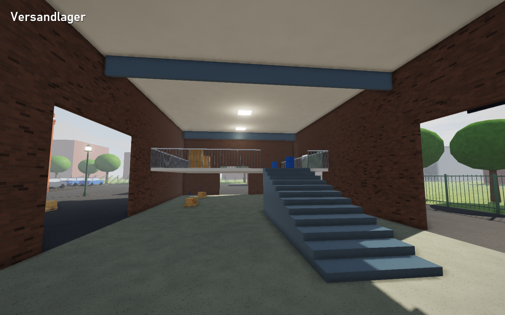
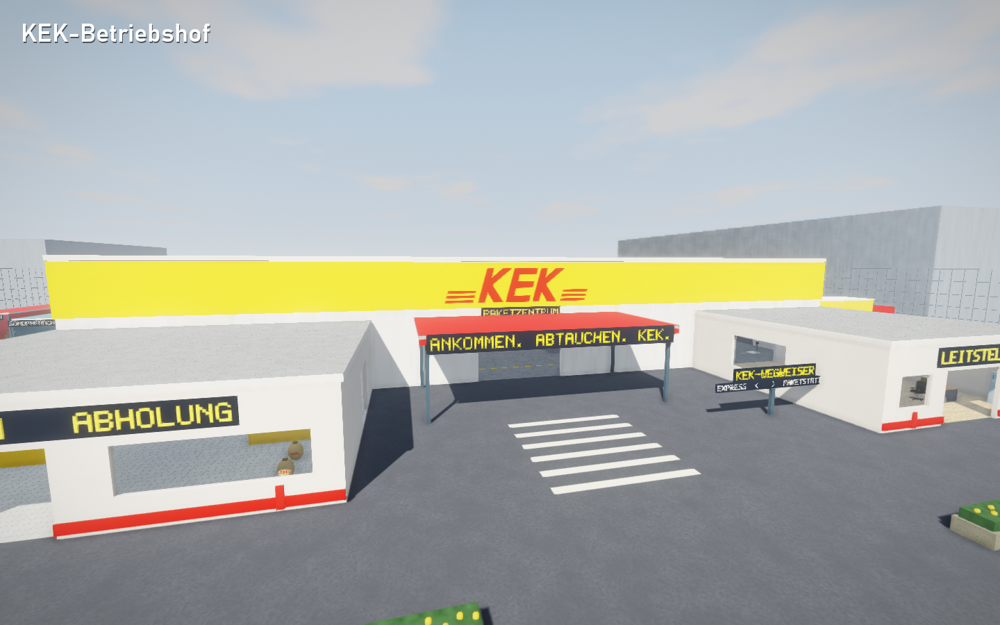

# Kek Me If You Can

Ein Prop-Hunt-Spiel mit **eigener C++-Engine**, ohne externe Laufzeitbibliotheken: Geometrie, Materialien, Taunts und Musik
werden beim Start prozedural erzeugt; aufbereitete Waffenaufnahmen ergänzen den Klang. Es gibt einen vollständigen Spielordner als ZIP und eine Einzel-EXE mit
eingebetteten Intros. Das Symbol ist eine Dose mit verschmitztem Blick: Das „can“ im Namen ist wörtlich gemeint.

## Herunterladen

**[Vollständigen Spielordner für Windows herunterladen – ZIP](https://github.com/GG2EZBoOm/kek-me-if-u-can/releases/latest/download/KekMeIfYouCan-Windows.zip)**

Das ZIP vollständig entpacken, dann **KekMeIfYouCan.exe** im entpackten Ordner starten. Es enthält die kleine
Spiel-EXE (rund 2,8 MB), das Konsolen-/Serverprogramm, alle drei Intro-Videos in `data/video`, eine Anleitung, Audio-Credits und
SHA-256-Prüfsummen. Eine Installation ist nicht nötig. Den Ordner zusammenlassen.

Alternativ: [Einzel-EXE mit eingebetteten Videos](https://github.com/GG2EZBoOm/kek-me-if-u-can/releases/latest/download/KekMeIfYouCan.exe)
oder [Konsolen-Version](https://github.com/GG2EZBoOm/kek-me-if-u-can/releases/latest/download/KekMeIfYouCanCLI.exe).
`KekMeIfYouCan-Ordner.exe` in den Release-Dateien ist die Update-Datei für die Ordner-Ausgabe; für einen neuen Download das ZIP nehmen.
Alle Versionen stehen unter [Releases](https://github.com/GG2EZBoOm/kek-me-if-u-can/releases/latest).

**Auch „Code → Download ZIP“ enthält jetzt das fertige Spiel.** Das gesamte ZIP entpacken und
**KekMeIfYouCan.exe direkt im obersten entpackten Ordner** starten. `data/video` und `folder-install.txt`
bleiben daneben. Zusätzlich liegen in diesem Download die Projektdateien; ein Compiler ist zum Spielen nicht nötig.
Ältere ZIPs wie `kek-me-if-u-can-main(1).zip` bitte neu herunterladen. Die automatisch erzeugten
„Source code“-Archive älterer Release-Tags enthalten weiterhin den damaligen Stand.

Die Programme sind derzeit **nicht digital signiert**. Windows kann sie daher weiterhin warnen oder blockieren;
die Aufteilung in einen Spielordner garantiert keine Freigabe. Fehlt „Trotzdem ausführen“, bitte den vollständigen
Meldungstext prüfen: SmartScreen-Richtlinien, Smart App Control und ein konkreter Virenfund sind unterschiedliche Ursachen.
Die Prüfsummen dienen dem Dateivergleich und ersetzen keine Sicherheitsprüfung.
[Microsoft erklärt SmartScreen und Signaturen.](https://learn.microsoft.com/en-us/windows/apps/package-and-deploy/smartscreen-reputation)

### Intros

Beim Start laufen drei Intro-Videos: Kekish Games, die Engine und das Spiel. Mit **Leertaste**, Enter oder einem
Klick geht es zum nächsten, **Esc** überspringt alle. In den Einstellungen lassen sie sich abschalten, `--no-intro`
überspringt sie für einen Start. In der Ordner-Ausgabe liegen sie unter `data/video`, in der Einzel-EXE sind sie
eingebettet. Beide Ausgaben verwenden Windows Media Foundation.

### Automatische Updates

Beim Start fragt das Spiel im Hintergrund das neueste Release auf GitHub ab. Gibt es eine neuere Version, lädt es die
EXEs, prüft Größe und SHA-256-Prüfsumme und tauscht die Dateien aus. Kommt das Update direkt nach dem Start an,
startet das Spiel sofort neu, sonst zeigt das Hauptmenü „Update ist bereit“ mit einem Neustart-Knopf. Während eines
Spiels wird nichts unterbrochen. In den Einstellungen lässt sich das abschalten oder von Hand prüfen.
`--no-update` überspringt die Prüfung für einen Start.
Die Ordner-Ausgabe bleibt bei EXE-Updates klein; dafür `folder-install.txt` behalten. Wenn sich die Videos ändern,
das neue vollständige ZIP herunterladen. Beide Ausgaben enthalten dieselben Spielregeln und Karten.

### Taunts und Waffenklänge

Alle **16 Taunts** besitzen jeweils **drei neu gestaltete Varianten**: von der Quietscheente mit abschließendem
Quietscher über den absackenden Trompeten-Fail bis zum ungeduldigen Glockenläuten und dem verspäteten letzten
Klatscher beim Applaus. Die Darbietung wechselt bei jedem Taunt. Lautstärken sind angeglichen, Anfänge und Enden
weich ausgeblendet. Länge, Punkte und Abklingzeiten bleiben gleich. Klone spielen dieselbe Variante wie ihr Besitzer.

MP-Schüsse, leere Abzüge, Nachladen sowie Holz-, Metall-, Glas- und Bodentreffer verwenden **24 aufbereitete
Aufnahmen**. Sie sind in allen EXEs eingebettet und kommen auch über den bisherigen Auto-Updater an.
Die großen Gefechts-Atmosphären sind nicht enthalten: Hintergrundschüsse würden die Ortung echter Spieler stören.

Zusätzliche Soundeffekte von **[ZapSplat](https://www.zapsplat.com)**, **GMA** und **Skyclad Sound**.
Credits und Lizenz stehen in [res/audio/CREDITS.txt](res/audio/CREDITS.txt) und im Spielordner. Die eingebettete
Aufnahme-Bank gehört zum Spiel und darf nicht als eigenständige Soundbibliothek weitergegeben werden.
Die Taunts selbst sind eigene prozedurale Klangentwürfe.

## Selbst bauen

```bash
build.bat
```

Danach `KekMeIfYouCan.exe` starten. Voraussetzung: Visual Studio 2022/2026 mit „Desktopentwicklung mit C++“
(liefert Compiler, CMake und Ninja mit).
`./package.ps1` in PowerShell erstellt danach `build/package/KekMeIfYouCan-Windows.zip`.

## Spielprinzip

- **Props** verwandeln sich in Gegenstände der Karte und verstecken sich. Wer bis zum Rundenende überlebt, gewinnt.
- **Jäger** sind während der Versteckphase blind. Danach suchen sie, aber **jeder Treffer auf ein falsches Objekt kostet Lebenspunkte**.
- Nach jeder Runde rotieren die Teams, sodass jeder einmal jagt.

### Was dieses Prop Hunt besser macht

| Feature | Beschreibung |
|---|---|
| Exakte Trefferzonen | Schüsse treffen die echten Einzelteile eines Objekts: Durch die Lücke zwischen Stuhlbeinen schießt man vorbei. |
| Faire Tarnung | Echte und verwandelte Objekte werden identisch gerendert und ausgeblendet. Es gibt keine optischen Unterschiede, die Spieler verraten. |
| Ausrichtung übernehmen | Beim Verwandeln übernimmt man die Drehung des Vorbilds und sperrt sie automatisch, damit man sich sauber in Reihen einfügt. |
| Drehung mit Kollision | Große Objekte lassen sich nicht in Wände drehen. Ein Sofa muss sich seitlich durch die Tür schieben. |
| Schwere Props schlagen zurück | Mit Umschalt und 1,5 m freiem Anlauf rammen; aus ausreichender Höhe auf Sucher fallen. HUD markiert geeignete Formen und zeigt die Abklingzeit. |
| Taunts mit Punkten | 16 Taunts mit je drei Varianten (Präsidentenglocke, Applaus, Kuckuck, Quietscheente …). Längere Taunts bringen mehr Punkte. |
| Zwangs-Taunt | Wer zu lange still ist, tauntet automatisch: alle 45 s, im Endspurt alle 20 s. |
| Köder | Props stellen zwei Kopien ihrer Tarnung auf. Treffer darauf kosten die Jäger Lebenspunkte. |
| Sonar | Jäger lösen einen Ping aus, auf den nahe Props hörbar antworten. |
| Granate | Eine pro Runde, für verdächtige Gruppen. |
| Waffenwerkbank | MP, Schrotflinte und Pistole mit passenden Anbauteilen, vier Build-Vorlagen, 3D-Vorschau und wirksamen Handhabungswerten. |
| 3D-Klang mit Verdeckung | Geräusche hinter Wänden klingen gedämpft. So lassen sich Taunts orten. |
| Bots für beide Teams | Prop-Bots suchen sich passende Gruppen gleicher Objekte, richten sich aus, verteilen sich über die Karte und fliehen bei Treffern. Jäger-Bots gehen Geräuschen nach, nutzen Sonar und geben Testschüsse ab. |
| Ausgerüstete Sucher | Geformte Uniformen, Plattenträger mit Taschen und Funkgerät, Schutzbrille, Headset und Stiefel. Arme greifen die Waffe per Zweigelenk-IK; Lauf- und Hockposen werden animiert. |
| Infektionsmodus | Gefundene Props jagen mit (optional). |
| Lebendige Karten | Fahnen wehen im Wind, Riesenrad und Kettenflieger drehen sich. |
| Freie Durchgänge | Gegenstände, die eine Tür versperren würden, werden beim Kartenbau automatisch weggelassen. Ein Test prüft jede Tür. |
| Mehrspieler übers Internet | Bis zu 16 Spieler. Einladungscode, automatische Portfreigabe am Router (UPnP) und Discord-Einladungen (siehe unten). |

## Waffenwerkbank

Im **Hauptmenü**, bei der Spielvorbereitung oder über **Esc → Waffenwerkbank** baust du MP, Schrotflinte und Pistole um.
Waffe auswählen, links einen Anschluss anklicken und rechts das gewünschte Teil montieren.
Die 3D-Vorschau lässt sich mit gedrückter linker Maustaste drehen; Werte und Unterschiede zum Werksbuild stehen darunter.



| Anschluss | Auswahl |
|---|---|
| Visierung | Kimme/Korn, Reflex, Holo und Prisma mit 2,5× Zielansicht; Pistole: Kimme/Korn oder Micro-Reflex |
| Lauf | Standard, Kompakt, Präzision/Sport |
| Mündung | Offen/Feuerdämpfer, Kompensator bzw. Choke, Schalldämpfer |
| Schaft | Standard, leicht, stabil/gepolstert; kein Schaftanschluss an der Pistole |
| Magazin | MP: 20/30/50 Schuss; Schrotflinte: 4/6/8 Patronen; Pistole: 10/15/20 Schuss |
| Griff | Langwaffen: Vordergriff/Pumpe; Pistole: Polymer-, gummierte oder schlanke Griffschalen |

Die vier Vorlagen **Standard, Kompakt, Kontrolle und Gedämpft** sind sofort spielbar. Jeder Build bleibt in
`prophunt.ini` gespeichert. Gewicht, Anschlagzeit, Rückstoß, Streuung, Kapazität und Nachladezeit ändern sich mit den Teilen;
es gibt keinen Build ohne Nachteile. Schalldämpfer reduzieren Schussknall, Hörweite und Mündungsblitz.
Gesperrte Kombinationen zeigen beim Überfahren mit der Maus den Grund: Der kurze MP-Handschutz nimmt keinen
Vertikalgriff auf; unter den kurzen Schrotlauf passt keine 8er-Magazinverlängerung.

Der Gastgeber prüft alle Teile. **Bis zum Ende der Versteckphase** werden Umbauten übernommen;
während der Jagd gilt eine Änderung **ab der nächsten Runde**. Auch bei einem späten Beitritt während der Jagd
wird der gespeicherte Build erst zur nächsten Runde angelegt. Alle Teilnehmer müssen **Version 1.0.7** verwenden
(Netzwerkprotokoll 7). Andere Spieler sehen dieselben montierten Bauteile.

Die Handhabung nutzt zeitabhängigen Anschlag, serverseitigen Rückstoß, Sprint-Erholung und getrennte Bewegungen
für Hände, Magazin, Verschluss und Pumpgriff. Die Schrotflinte lädt **Patronen einzeln**; mit Feuer lässt sich
unterbrechen, sobald mindestens eine Patrone geladen ist. Ein Waffenwechsel bricht das Nachladen ab.
Die Modelle sind eigene prozedurale Spielmodelle. Die Werkbank ist eine erste modulare Ausbaustufe mit sechs
Anschlüssen; ein Inventar mit hunderten Einzelteilen, Verschleiß und eine ballistische Simulation gehören noch nicht dazu.

Die **9-mm-Pistole auf Taste 3** schießt halbautomatisch: ein Schuss pro Klick, 15 Schuss im Standardmagazin,
22 Schaden auf kurze Distanz und 1,45 Sekunden für einen Magazinwechsel. Ihr Schlitten bewegt sich beim Schuss,
bleibt nach dem letzten Schuss offen und schließt beim Nachladen. Sie hat eigene Schuss- und Nachladegeräusche;
Bots ziehen sie als Ersatzwaffe, wenn die Hauptwaffe leer ist. Die **Granate liegt auf Taste 4**.



Die Außenatmosphäre enthält seit 1.0.6 nur Wind, **kein wiederkehrendes Vogelgezwitscher**.

## Spezialmodi

Der **Lobbyleiter** wählt im Startmenü den Modus. Im **Esc-Menü** kann er einen Modus für die nächste Runde
vormerken; die laufende Runde behält ihre Regeln. Gäste sehen die Auswahl, können sie aber nicht ändern.
Alle Modi funktionieren mit Bots und Freunden auf allen fünf Karten. Infektion ist zusätzlich einschaltbar.

| Modus | So spielt er sich |
|---|---|
| **Prop-Roulette** | Alle 25 Sekunden eine neue Zufallsform aus der Karte, mit fünf Sekunden Vorwarnung. Die Form muss am aktuellen Ort passen; der Lebensanteil bleibt erhalten. Während der Jagd ist E gesperrt. |
| **Klon-Alarm** | Q stellt bis zu drei eigene Klone auf. G tauscht dich mit dem nächsten eigenen Klon innerhalb von 20 m, mit zehn Sekunden Abklingzeit. Klone imitieren Taunts und Sonarantworten, verschwinden nach 45 Jagdsekunden; alle zwölf Sekunden kommt eine Ladung zurück. |
| **Hummeln im Hintern** | Wer als Prop sieben Sekunden am selben Platz bleibt, hupt und verrät seine Position. Ein Meter Ortswechsel setzt den Alarm zurück. |
| **Mondschicht** | 40 Prozent Schwerkraft für beide Teams und Granaten: hohe Sprünge und lange Flugbahnen. |
| **Wundertüte** | Jede Runde einer der vier Spezialmodi, ohne direkte Wiederholung. |

**Klassisch** bleibt ebenfalls wählbar. Für Mehrspieler müssen alle dieselbe aktuelle Version verwenden;
das Netzwerkprotokoll wurde für die neuen Regeln erweitert.

## Karten

Die Karte wählst du im Hauptmenü über die Kartenkarte unten rechts oder beim Spielstart.

### Dresdner Zwinger

Eine für Prop Hunt verkleinerte, stilisierte Interpretation mit eigener Geometrie:



- Innenhof mit **vier Brunnenbecken**, Orangenkübeln und Bänken
- **Kronentor** mit goldener Krone, Brücke und Graben; Wall- und Glockenspielpavillon
- Offene Bogengalerien und **begehbare Terrassen** mit vier Hofaufgängen, breiteren Pavillonrändern und Verbindung über das Kronentor
- Blumenbeete, Hofmedaillon, Sitzgruppen und gerahmte Gemälde in der Sempergalerie
- Sempergalerie, Porzellansammlung, Mathematisch-Physikalischer Salon und **Nymphenbad** mit Kaskade
- Sechs neue Tarnungen: Porzellanvase, Barockurne, Orangenkübel, Sandsteinfigur, historisches Fernrohr und Kunsttransportkiste

Architekturorientierung: [Schlösserland Sachsen – Highlights des Dresdner Zwingers](https://wissen.schloesserland-sachsen.de/haeuser-gaerten/dresdner-zwinger/highlights-der-architektur/).
Die Spielkarte ist kein maßstabsgetreuer Museumsplan. Alle Modelle entstehen im Spielcode.

Für einen dedizierten Server: `KekMeIfYouCanCLI.exe --server --map zwinger --bots 8`.

### Bundestag

Das Reichstagsgebäude auf drei Ebenen plus Dach:

- **Plenarsaal** mit 232 blauen Abgeordnetensitzen auf Sitzstufen, Rednerpult, Präsidium, Regierungs- und
  Bundesratsbank, Bundesadler und Besucher- und Pressetribünen
- **Glaskuppel** mit zwei begehbaren Spiralrampen, Aussichtsplattform und Spiegelkegel. Durch den Glasboden
  sieht man in den Plenarsaal.
- **Westportal** mit Säulen und der Inschrift „DEM DEUTSCHEN VOLKE“, Eingangshalle mit Sicherheitsschleuse und
  großer Treppe
- Fraktionssäle, Sitzungssaal, Präsidialbüro, Pressezentrum, Lounge, Bibliothek, Poststelle, Kantine mit
  Currywurst-Theke, Küche, Lager, vier Ecktürme mit Treppenhäusern, Dachterrasse mit Dachrestaurant
- **Platz der Republik** mit Rasen, wehenden Fahnen, Besucherzentrum, Straße mit Polizeiwagen und der Spree.
  In der Ferne stehen Fernsehturm und Brandenburger Tor.
- **Besucherforum** mit überdachtem Infopunkt, Presseausrüstung und bepflanzten Versteckinseln

### Oktoberfest

Ein Festzelt auf der Theresienwiese in der Abenddämmerung:

- **Festzelt** mit Bierzeltgarnituren, Musikpodium in der Mitte, umlaufender **Empore mit Boxen**, Ausschank mit
  Fässern und Hendlküche, Wagenrad-Leuchtern und blau-weißem Himmel
- **Biergarten** mit blau-weißen Schirmen, Kastanien und Maibaum
- **Wirtsbudenstraße** mit Lichterketten und Ständen: Lebkuchen, Schießbude, Hendl, Mandeln, Steckerlfisch,
  Souvenirs, Zuckerwatte, Brezn und Lose
- **Fahrgeschäfte**: drehendes Riesenrad, Kettenflieger, Autoscooter-Halle und Kinderkarussell
- **Festinseln** mit Tischen und Fässern sowie überdachtes Fundbüro mit Fahrkartenbereich
- **Hinterhof** mit Toilettenhäuschen, Strohballen und Fässern. Im Hintergrund stehen Bavaria, Ruhmeshalle und
  die Türme der Frauenkirche.

### Nudelfabrik

Eine Backsteinfabrik mit Werkshof und zwei Produktionslinien:

- **Produktionshalle** unter einem verglasten Sheddach, mit drehenden Teigmischern, Nudelpresse, Schneidwerk,
  laufendem Nudelband und hängenden Spaghetti auf einer Stangenbahn
- **Laufstege auf vier Metern Höhe**, erreichbar über zwei Stahltreppen und mit Zugang zum Meisterbüro
- **Trockenraum**, Mehllager mit Hochregalen und Gabelstapler sowie eine Werkstatt
- **Verpackung** mit laufendem Kartonband, Paletten und einem begehbaren Lkw-Anhänger an der Laderampe
- **Bürotrakt** mit Kantine, Umkleide, Meisterbüro, Labor und Archiv
- **Außengelände** mit drei Mehlsilos, Parkplatz, Pförtnerhaus, Hinterhof und Schornstein
- **Versandlager 02** mit fünf Zugängen und begehbarer Galerie; Leergutcontainer, Pausenhof und zusätzliche Ladegruppen



Für einen dedizierten Server: `KekMeIfYouCanCLI.exe --server --map nudelfabrik --bots 8`.

### KEK-Paketzentrum

Gelb-rote Logistikhalle mit dem schrägen **KEK-Schriftzug und Streifen**, ohne das Avatar-Motiv im weißen Kreis:

- Zwei laufende Paketbänder mit Scanportalen und große Paketregale
- Eine begehbare Sortierbrücke mit zwei Treppen und Rundwegen
- Retourenschalter, Packplätze und Leitstelle
- Drei begehbare Lkw-Laderäume mit Ladetreppen und ein Betriebshof
- **Express-Umschlaghalle**, zwei begehbare Container, Service- und Pausenbereich sowie Paketstation
- Das umzäunte Gelände ist **106 × 94 Meter** groß, rund **49 % mehr Fläche** als zuvor.
  Bürofenster, Eingangsdach, Fassadenstreifen und Wegweiser gliedern die Außenbereiche.
- Zehn neue Tarnungen: Päckchen, Paket, zerbrechliches Paket, Versandrolle, Handscanner, Klebeband,
  Postsack, Sortierkiste, Rollcontainer und Etikettendrucker



Für einen dedizierten Server: `KekMeIfYouCanCLI.exe --server --map paketzentrum --bots 8`.

### Gegenstände

155 verschiedene Gegenstände. Im Bundestag gibt es unter anderem Aktenordner, Wasserglas, Laptop, Mate-Flasche,
Currywurst, Wahlurne, Präsidentenglocke, Büste und Ficus. Auf dem Oktoberfest kommen Maßkrug, Wiesnbrezn,
Lebkuchenherz, Bierfass, Hendl, Radi, Trachtenhut, Tuba, Teddybär, Gartenzwerg, Karussellpferd, Autoscooter und
viele mehr dazu. Die Nudelfabrik ergänzt 32 Gegenstände, darunter Mehlsack, Europalette, Spaghetti-Packung,
Tomatendose, Parmesanlaib, Trockenwagen, Hubwagen, Schutzhelm, Werkzeugkiste und Mikroskop.

## Steuerung

| | Allgemein | Jäger | Props |
|---|---|---|---|
| Linke Maustaste | | Schießen | |
| Rechte Maustaste | | Zielen | |
| E | | | In anvisiertes Objekt verwandeln |
| R | | Nachladen | Drehung sperren/lösen |
| Q | | Sonar | Köder platzieren |
| G | | Sonar | Im Klon-Alarm: mit eigenem Klon tauschen, sonst Köder |
| F | | | Zufälliger Taunt |
| T | | | Taunt-Auswahl |
| 1 / 2 / 3 / 4 | | MP / Schrotflinte / Pistole / Granate | Taunt wählen (bei offener Liste) |
| W A S D, Leertaste, Umschalt | Laufen, Springen, Sprinten | | |
| Strg / C | | Ducken | |
| Tab / Enter / Esc / F1 / F11 | Punkte / Chat / Pause / Hilfe / Vollbild | | |
| F8 / F9 | Discord-Beitrittsanfrage annehmen / ablehnen | | |

## Mehrspieler

### Freunde einladen

1. Wähle **Server erstellen**. Die Windows-Firewall fragt beim ersten Mal nach einer Freigabe, die du erlauben musst.
2. Das Spiel gibt den **UDP-Port 27015** automatisch am Router frei (UPnP). Im **Esc-Menü** öffnet rechts der Knopf
   **„Freunde einladen“** die Karte mit
   - einem **Einladungscode** wie `KEK-TE294-3VBJZ`. Er enthält deine IPv4-Adresse und den Port.
   - **Einladung kopieren**: Das kopiert eine fertige Nachricht für Discord oder einen anderen Chat.
   - **Ziel: Internet / Heimnetz**: Internet ist voreingestellt. Heimnetz-Codes sind ausdrücklich für das gleiche
     Netzwerk oder VPN vorgesehen.
   - Beim Hosten wird die öffentliche IPv4 automatisch über den Router und per HTTPS bei api.ipify.org ermittelt.
     Wenn das fehlschlägt, erscheint **IP erneut suchen**. Offline-Spiele starten keine solche Abfrage.
3. Deine Freunde wählen **Server beitreten** und fügen den Code, die IP-Adresse oder gleich die ganze Nachricht ein
   (Einfügen-Knopf neben dem Feld). Server im selben Netzwerk erscheinen automatisch in der Liste.
4. Freie Plätze werden mit Bots aufgefüllt. Tritt ein Mensch bei, macht ein Bot Platz.

Wenn das automatische Freigeben nicht klappt, gib im Router UDP-Port 27015 für deinen PC frei. Das Esc-Menü zeigt
dafür die passende lokale Adresse an. Bei Anschlüssen ohne eigene öffentliche IPv4 (Carrier-NAT/DS-Lite)
braucht ihr für Internetspiel eine öffentliche IPv4 oder geeignete VPN-Verbindung. Eine private
WAN-Adresse am Router kann auch Doppel-NAT bedeuten; dort müssen beide Router entsprechend weiterleiten.

### Discord

Läuft Discord auf dem PC, zeigt dein Profil Karte, Phase, Runde und Rolle. Freunde sehen bei einem Online-Spiel
**„Beitreten“** und landen mit einem Klick auf deinem Server. Ist das Spiel bei ihnen noch zu, startet Discord es.
Der Beitritt wird erst mit einer öffentlichen Serveradresse angeboten; lokale IPs werden nicht als
Discord-Einladung veröffentlicht. LAN-Gäste erhalten dafür die öffentliche Adresse des Gastgebers.
Fragt jemand per Discord an, erscheint rechts ein Hinweis, den du mit **F8** annimmst oder mit **F9** ablehnst.

Damit Discord das Spielsymbol anzeigt, lade im [Discord Developer Portal](https://discord.com/developers/applications)
bei der Anwendung (ID `1563117727370055710`) unter **Rich Presence → Art Assets** die Datei `res/icon_1024.png` mit dem
Namen **`logo`** hoch. Der Name der Anwendung dort ist der Spielname, den Discord anzeigt.

### Dedizierter Server

```bash
KekMeIfYouCanCLI.exe --server --map oktoberfest --bots 8 --rounds 6 --name "Mein Server"
```

Der Server schreibt beim Start seinen Einladungscode fürs Heimnetz ins Fenster. Er aktualisiert sich nicht von
selbst. Ein Update holt dieser Befehl:

```bash
KekMeIfYouCanCLI.exe --update
```

## Für Entwickler

```bash
KekMeIfYouCanCLI.exe --test 3
```

```bash
KekMeIfYouCanCLI.exe --nettest
```

```bash
KekMeIfYouCan.exe --gameshot build\game
```

`--test` prüft Einladungscodes, Updater, Audio, Bewegung, Türen und Wegfindung auf allen Karten. Für die Nudelfabrik werden
zusätzlich alle Startplätze, die Förderband-Umläufe und die Sperre der Spaghetti-Bahn geprüft. Danach spielt es auf jeder
Karte ein komplettes Bot-Match im Zeitraffer. **26 Routen werden mit der tatsächlichen Bot-Steuerung und Spielerkollision
abgelaufen**, darunter die Zwinger-Terrassen in beide Richtungen, alle vier Brunnen, die Bundestagskuppel und die neuen
Lagerbereiche. Das Navigationsgitter berücksichtigt die Sucherbreite auf einem 25-cm-Raster, blockierte diagonale Ecken
und übereinanderliegende Etagen. Zwei Prüfungen gelten der Grafik und
der Fairness:

- **Flackern:** Kein Flächenpaar darf in derselben Ebene liegen (bis 5 mm Abstand) und dabei unterschiedlich aussehen.
  Solche Flächen flackern, weil der Tiefenpuffer sie nicht trennen kann.
- **Blattwerk:** An keiner begehbaren Stelle darf man in Büschen oder Hecken stecken, die nur Optik sind.

Die Spezialregeln werden zusätzlich in einer kontrollierten Arena und mit Bot-Matches im Paketzentrum geprüft.
`--nettest` testet Server und Client über Loopback, einschließlich Moduswechseln und voller Lobby mit vielen Klonen.
`--soundcheck build/audio-preview` prüft die Aufnahme-Bank, Mixer-Transienten und alle 48 Taunt-Varianten.
Es exportiert die eigenen prozeduralen Taunts und eine zusammenhängende Hörprobe als WAV. Die lizenzpflichtigen
Waffenaufnahmen werden dabei nicht als Einzeldateien ausgegeben. Zum Neuaufbereiten der vom Projektinhaber
bereitgestellten Aufnahmen dient `python tools/build_sound_bank.py <Downloadordner>` (benötigt NumPy).
`--gameshot` klickt sich automatisch durch Menüs und Spiel und
speichert Screenshots, auch vom Einladungsmenü. Dabei werden weder der Router noch Discord angesprochen.

Einzelne Stellen einer Karte rendern (Kamera, Blickpunkt). `--hunters` stellt am Blickpunkt vier Jäger in
verschiedenen Posen auf:

```bash
KekMeIfYouCanCLI.exe --shots build\cam --map bundestag --cam -50 0.3 1.6 -50 -0.1 0 --hunters
```

Das Programmsymbol erzeugt `tools/make_icon.py` (benötigt Pillow) als `res/icon.ico` und `res/icon_1024.png`.

### Neue Version veröffentlichen

1. Version in `src/game/Version.h` erhöhen (z. B. `1.0.1`) und alles committen.
2. `release.bat` ausführen. Es pusht den Stand und das Tag `v1.0.1`.
3. GitHub Actions (`.github/workflows/release.yml`) baut, führt `--test` und `--nettest` aus und erstellt das
   Release mit vollständigem Spielordner-ZIP, beiden GUI-Ausgaben, CLI und Prüfsummen. Ab dann bekommen Spieler
   die neue EXE beim nächsten Start, sofern automatische Updates aktiviert sind.

Das Update testen, ohne eine neue Version zu bauen: Die EXEs in einen leeren Ordner kopieren und dort Folgendes
ausführen. Der Befehl gibt eine ältere eigene Version vor und installiert dann das aktuelle Release.

```bash
KekMeIfYouCanCLI.exe --update --pretend-version 0.0.1
```

### Aufbau

```
src/engine   Plattform (Win32/WGL), eigener GL-Loader, Renderer (HDR, kaskadierte Schatten, SSAO, Bloom, FXAA,
             prozedurale Materialien), UI mit Milchglas und GDI-Schriftatlas, Audio-Mixer (waveOut),
             UDP-Netzwerk, UPnP-Portfreigabe, Videowiedergabe (Media Foundation, NV12-Shader)
src/game     Prop-Katalog, Karten-Baukasten, Karten (maps/), Kollision und Bewegung, Simulation,
             Navigationsgitter und Bots, Netzwerkprotokoll, Einladungscodes, Discord-Anbindung (IPC ohne SDK),
             Auto-Update (WinHTTP + SHA-256), Darstellung, Klangsynthese, Menüs und HUD
res          Programmsymbol, Versionsinfo, Intro-Videos (res/video, in die Spiel-EXE eingebettet)
tools        Symbol-Generator
.github      Release-Workflow (bauen, testen, veröffentlichen)
```
